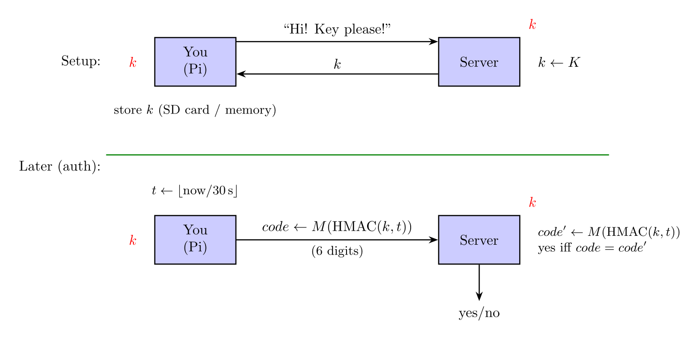
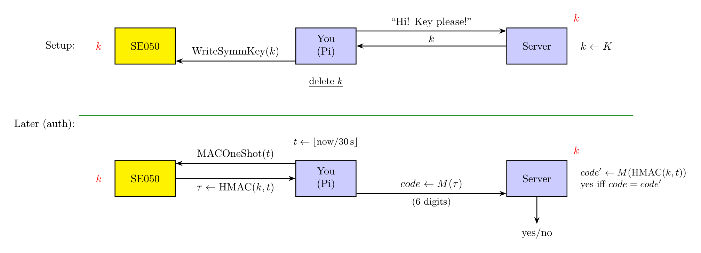
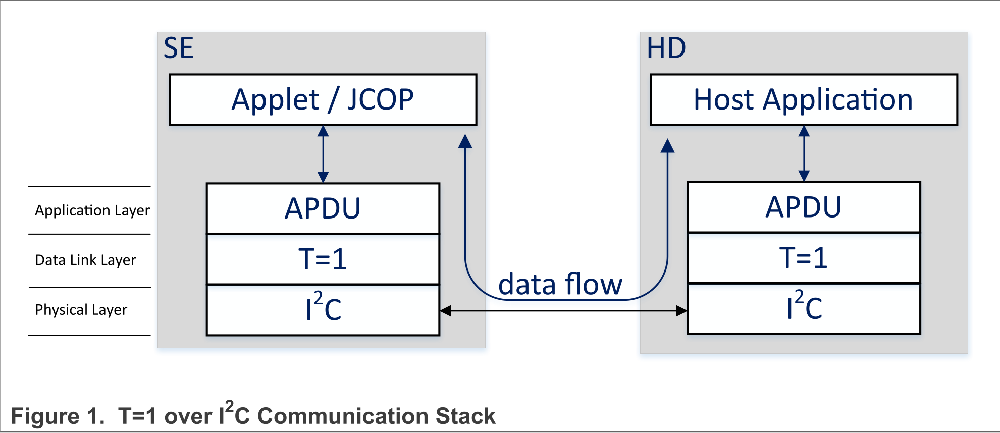

# SE050 security enclave

The SE050 is a powerful crypto chip that can handle many crypto operations in a secure way.
Why do we need such a chip? Imagine the following scenario: you want to keep a secret key on
the Pi, which you will use to sign, encrypt, or decrypt data. An naive approach is to keep
the key on the SD card, and read it into memory when you need it, but this gives an attacker
(who can read the SD card or access the Pi's memory) direct access to the key.

A better approach is to keep the key in a secure enclave, which the Pi can only instruct to use
the key, but cannot use the key directly. The SE050 is such a secure enclave, supporting many
cryptographic operations, covering symmetric and asymmetric crypto, as well as secure storage
of keys and data.

In this lab, we will build a simple TOTP generator (Google Authenticator) that uses the SE050
to store the secret key and generate codes. The natural advantage of using this chip instead
of Google Authenticator is that once the secret key is stored, nobody can read it back, and the
specific chip becomes the physical "key" to generate codes - no chip, no codes. This
can lead to backup problems, but it is a good tradeoff for security.

## How TOTP works

TOTP (Time-based One-Time Password) is a standard for generating one-time passwords based on a
shared secret key and the current time. The basic idea is that both the client (your Pi) and
the server (e.g., Google) share a secret key, and they both generate a one-time code using a
[Hash-based Message Authentication Code (HMAC)](https://en.wikipedia.org/wiki/HMAC) with the
shared secret key and the current time (in 30-second intervals). The setup workflow
is roughly:

<p align="center">
  
</p>

So the secret key was never exchanged after the setup, and because of the irreversibility of HMAC,
anyone who sees the code cannot derive the secret key.

However, the client will have to keep the key somewhere, to generate codes for future auth,
so the key may be a target for attackers. This is where the SE050 comes in, and the map then becomes:

<p align="center">
  
</p>

The key touches your memory exactly once, on its way into the chip, and from then on the
HMAC is computed inside the SE050. The only thing left on your side is the truncation `M()`
from the raw MAC down to the 6-digit code, which needs no secret at all. Thus, an attacker
who tries to read your memory or SD card will never see the secret key, and cannot generate codes.

## Prep
Since all of the SE050 boards are soldered by hand, there may be some bad boards despite our best efforts.
Please run the staff binary provided to check if the board is working before proceeding.

## Talking to the chip

Great! Now we know (a chapter of) CS255! Time to think about actually building it out!
The SE050 sits on the I2C bus, which we are very familiar with through the PMU labs. However,
the operation of this chip feels a bit more bureaucratic, since there are many layers of protocol
abstractions above I2C. Roughly, the layers are as follows:

<p align="center">
  
</p>

Following is a ground-up guide on how to implement each of these layers. Primary references
are the SE050 APDU Specification (AN12413) and the NXP SE05x T=1 Over I2C Specification (UM11225).

### I2C

We can reuse the I2C code from previous labs, but with one important bit to handle:
**the SE050 NAKs** when it's busy. The staff libpi driver `panic`s when it sees a NAK, but that
is normal for the SE050, which just to indicate that it's busy and cannot handle the request.
Implement the I2C code to report NAKs instead of panicking, and use the `i2c_xfer_poll` function
as a retry wrapper.

### T=1

The SE050 uses the T=1 protocol over I2C as the link layer, details in UM11225 (2.1 T=1 Block Frame Format).
In a nutshell, the T=1 protocol defines a frame format:

```
NAD | PCB | LEN | INF   | CRC  <- fields
1B  | 1B  | 1 B | LEN B | 2B   <- size
```

- NAD is the node address, which in our case, is always `0x5a` for Pi to chip, and `0xa5` for chip to Pi
  (Table 4, pp. 5, UM11225).
- PCB is the protocol control byte that indicates the type of the frame (I-block, R-block, S-block),
  and the sequence number of the frame (Table 5/6, pp. 6, UM11225). For this lab, we will not use chaining
  for I-blocks, so the M bit should always be 0. The N(S) and N(R) bits are the sequence numbers for I-blocks
  and R-blocks, which should be toggled between 0 and 1 for each new block sent. We will leave S-blocks for later
  since it is a bit more complicated.
- LEN is the length of the INF field, which can be 0-254 bytes (note `0xff` is an indicator of extended length,
  which we will not use in this lab).
- INF is the information field, which contains the data of `LEN` bytes.
- CRC is the CRC16-X25 checksum of the NAD, PCB, LEN, and INF fields, which is 2 bytes, **LSB first**.

Example: to send an I-block with 3 bytes of data `0x01 0x02 0x03`, the frame would be:

```
NAD | PCB | LEN | INF            | CRC
0x5a| 0x00| 0x03| 0x01 0x02 0x03 | CRC() & 0xFF, (CRC() >> 8) & 0xFF
```

after receiving the reply, we want to follow up with say `0x04 0x05 0x06`, the frame would be:

```
NAD | PCB | LEN | INF            | CRC
0x5a| 0x40| 0x03| 0x04 0x05 0x06 | CRC() & 0xFF, (CRC() >> 8) & 0xFF
```

note that PCB has the N(S) bit toggled to 1, and the CRC is computed over the new frame.

### APDU format

The APDU (Application Protocol Data Unit) is the application layer protocol that defines the commands
and responses to the SE050. The APDU is encapsulated in the INF field of the T=1 frame.
Primary source of the APDU is `4.1 APDU Format` in the AN12413 document (pp. 32). A quick overview of
the APDU format is as follows:

```
CLA | INS | P1 | P2 | Lc | Data | Le   <- fields
1B  | 1B  | 1B | 1B | 1B*| Lc B | 1B   <- size
```

- `CLA` is fixed to `0x80` for SE050, except for a few special instruction (e.g., `SELECT`, which we will use later).
- `INS` is the instruction code, which indicates the operation to perform, check `4.3.3 Instruction` Table 19 in AN12413
  (pp. 35) for the list of instructions.
- `P1` and `P2` are parameters for the instruction, which are instruction-specific. Each command will have its own allowed
  list of P1/P2 values, check the command's description in AN12413 for details. Possible values are listed in
  `4.3.4 P1 parameter` and `4.3.5 P2 parameter` (pp. 35-38).
- `Lc` is the length of the Data field, which can be 1-255 bytes. If length of data is 0, Lc is omitted. Per ISO7816-4,
  Lc can be extended to 3 bytes, but we will not use that in this lab.
- Data is the boring body.
- `Le` is the length of the expected response data, which can be 0-255 bytes. If length of expected response is 0,
  Le is omitted. Per ISO7816-4, Le can be extended to 3 bytes, but we will not use that in this lab.
  Per AN12413, Le is not explicitly checked, but should always be smaller than `0x8000` (pp. 32).

Note: this APDU structure is only used for sending messages to the chip, and the format of responses from the chip can be
different per command. Make sure to look for `R-APDU Body` in the command's description in AN12413 for details. Many commands
also carry a status word (SE), which is a 2-byte code indicating the result of the command, indicated in the `R-APDU Trailer`
table of the command. It is safe to ignore it for this lab, but the best practice is to always check it.

### TLV

Before we can dive into the actual commands, TLV is yet another encoding to come into our way. TLV stands for Tag-Length-Value,
and the version we are using roughly follows [ISO7816-4 Annex D](https://cardwerk.com/iso7816-4-annex-d-use-of-basic-encoding-rules-asn-1/).

The rough shape of a TLV this chip wants is as follows:

```
Tag | Length | Value    <- fields
1B  | 1/2/3B | Length B <- size
```

- Tag is a 1-byte identifier for the type of data, check `4.3.9 TLV tags` in AN12413 (pp. 39) for the list of tags.
- Length is the length of the Value field, which can be 1-127 bytes. For longer data, the length can be extended to 2 or 3 bytes.
  This is **important** since sometimes the data sent back by the chip can be using the extended format despite it is actually small.
  - For Length <= 127, the only byte encodes it.
  - For Length <= 255, the first length byte is `0x81`, and the second byte encodes the length.
  - For Length <= 65535, the first length byte is `0x82`, the second and third bytes encode the length in **big-endian** format.
- Value is the actual data, which is `Length` bytes long.

## Build!

With all the wrappings and encodings out of the way, we can finally talk about how to build something with the chip.
For the TOTP application, we will be implementing a few commands to store the key, generate HMAC, and erase the key.
Specifically, the commands we will need are (references to AN12413):

- 4.4 Applet selection (pp. 47)
- 4.7.1.3 WriteSymmKey (pp. 60), check 4.7.1 WriteSecureObject (pp. 57) for syntax of generic write command
- 4.13.4 MACOneShot (pp. 90), use `HMAC_SHA1` as the MACAlgo.
- 4.7.4.5 DeleteSecureObject (pp. 70)

### Command basics

Taking 4.4 Applet selection (pp. 47) as an example.
This command is for "initializing" the chip with the SE050 IoT applet.

Under the hood, this command is also an APDU command that gets sent as an I-block, but since everything there is static and no
TLV is involved, we can just send it has a hardcoded bitstream over T=1. According to Table 51 (AN12413, pp. 48), the command is:

```
cmd[] = {0x00, 0xa4, 0x04, 0x00,
0x10, 0xA0, 0x00, 0x00,
0x03, 0x96, 0x54, 0x53,
0x00, 0x00, 0x00, 0x01,
0x03, 0x00, 0x00, 0x00,
0x00, 0x00}
```

As this is the first command we send, let's check the T=1 frame breakdown (the inner APDU breakdown is in table 51, AN12413, pp. 48):

```
NAD | PCB | LEN | INF    | CRC
0x5a| 0x00| 0x16| cmd[]  | 0xa8 0xc8
```

So that ^ goes on to the I2C bus, and we should get back a response like this:

```
NAD | PCB | LEN | INF | CRC
0xa5| 0x00| 0x09| ver | Some CRC
```

where `ver` is the version of the applet, likely `0x07 0x02 0x00 ...` which indicates version 7.2.0 applet version.

### Commands with TLV

Take 4.7.1.3 WriteSymmKey (pp. 60) as another example.
This command is for writing a symmetric key into the chip, which we will use to store the TOTP secret key.

Looking at Table 96 (AN12413, pp. 61), the APDU command needs:

- `P1 = P1_HMAC` because we are writing a key for HMAC usage
- `P2 = P2_DEFAULT`
- ~~`TLV[TAG_POLICY]`~~ (ignored since optional)
- ~~`TLV[TAG_MAX_ATTEMPTS]`~~ (ignored since optional, fancier auth features)
- `TLV[TAG_1]` = the id of the key, 4 bytes, "totp" in ASCII is the one for testing, anything should work as long as it is 4 bytes.
- ~~`TLV[TAG_2]`~~ (ignored since conditional, we are not using RFC3394)
- `TLV[TAG_3]` = the key data, the test key "12345678901234567890" is 20 bytes long.

Now we figure out the expected TLV breakdown for the command:

```
TLV[TAG_1]:
Tag  | Length | Value
0x41 | 0x04   | 't' 'o' 't' 'p'

TLV[TAG_3]:
Tag  | Length | Value
0x43 | 0x14   | '1' '2' '3' ... '0'
```

Then the APDU command breakdown is:

```
CLA | INS | P1  | P2  | Lc  | TLV[TAG_1]   | TLV[TAG_3]    | Le
0x80| 0x01| 0x05| 0x00| 0x1c| 0x41 ... 0x70| 0x43 ... 0x30 | -
```

and the T=1 frame is wrapping the APDU command with NAD = 0x5a, PCB = 0x00/0x40 (depending on the order you send stuff), ...
To help you cross check, the CRC of this command is `0x51 0x33`.

### TOTP!

After we have all the commands we need, we can finally implement the TOTP generator. The logic is as follows:

- Take the current Unix timestamp (in seconds from epoch), and divide it by 30 to get the current time step.
- Convert the time step to an 8-byte **big-endian** integer, which will be the message to HMAC.
- Ask the SE050 to compute HMAC-SHA1 of the message with the stored key, and get back a 20-byte MAC.
- Truncate the MAC to a 6-digit code using the standard TOTP truncation algorithm:

```python
mac = mac_bytes  # 20 bytes
offset = mac[19] & 0x0f
code = ((mac[offset] & 0x7f) << 24 |
        (mac[offset + 1] & 0xff) << 16 |
        (mac[offset + 2] & 0xff) << 8 |
        (mac[offset + 3] & 0xff)) % 1000000
```

For more details, check [RFC6238](https://www.rfc-editor.org/rfc/rfc6238.html) and
[Wikipedia](https://en.wikipedia.org/wiki/Time-based_One-time_Password_algorithm).

## Checking your results

Feel free to grab a few test vectors from [RFC6238 Appendix B](https://datatracker.ietf.org/doc/html/rfc6238/#appendix-B)
to check your implementation. The test vectors we included is for key `12345678901234567890` and time `1111111109`, and code
should be `081804` (or `07081804` for the 8-digit version).
